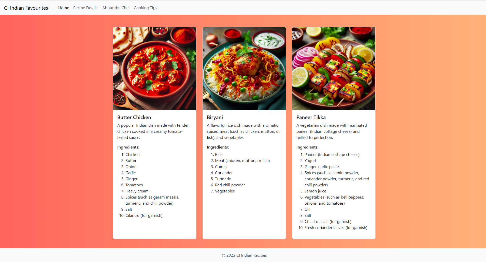

# CI Indian Favourites

A responsive recipe card webpage showcasing popular Indian dishes using HTML5, CSS3, Bootstrap 5, and custom styling.

## Project Overview

This project was created as part of the Code Institute AI-Augmented Bootcamp End-of-Lesson Challenge.

The objective was to recreate a recipe card webpage as closely as possible to a provided prototype while utilising:

- HTML5
- CSS3
- Bootstrap 5
- GitHub Copilot
- Manual code refinement

The page features a responsive navigation bar, recipe cards, food images, ingredient lists, and a footer.

---

## Features

### Navigation Bar

- Responsive Bootstrap navbar
- Brand title
- Navigation links:
  - Home
  - Recipe Details
  - About the Chef
  - Cooking Tips

### Recipe Cards

The page contains three Indian recipe cards
